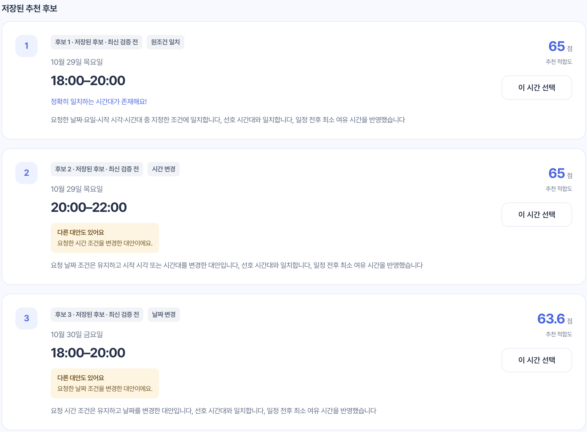
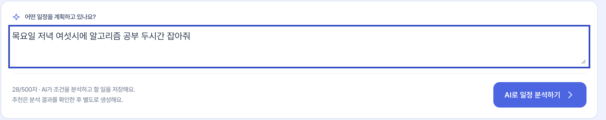
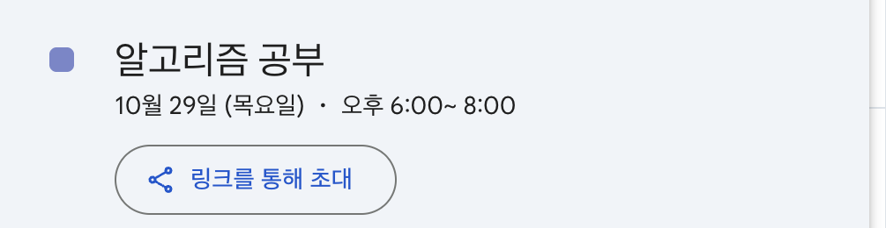
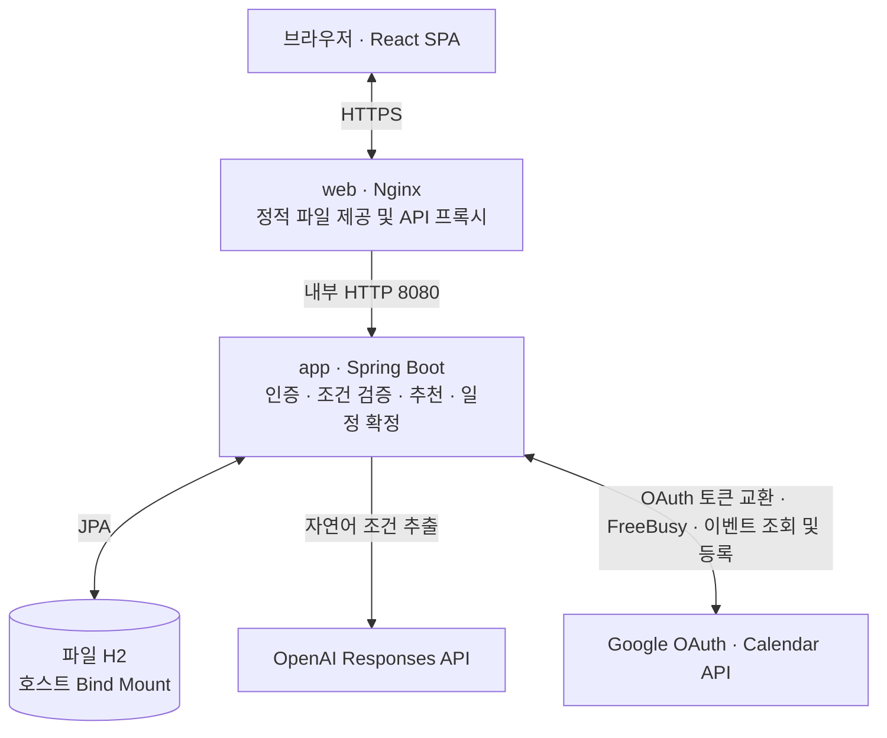
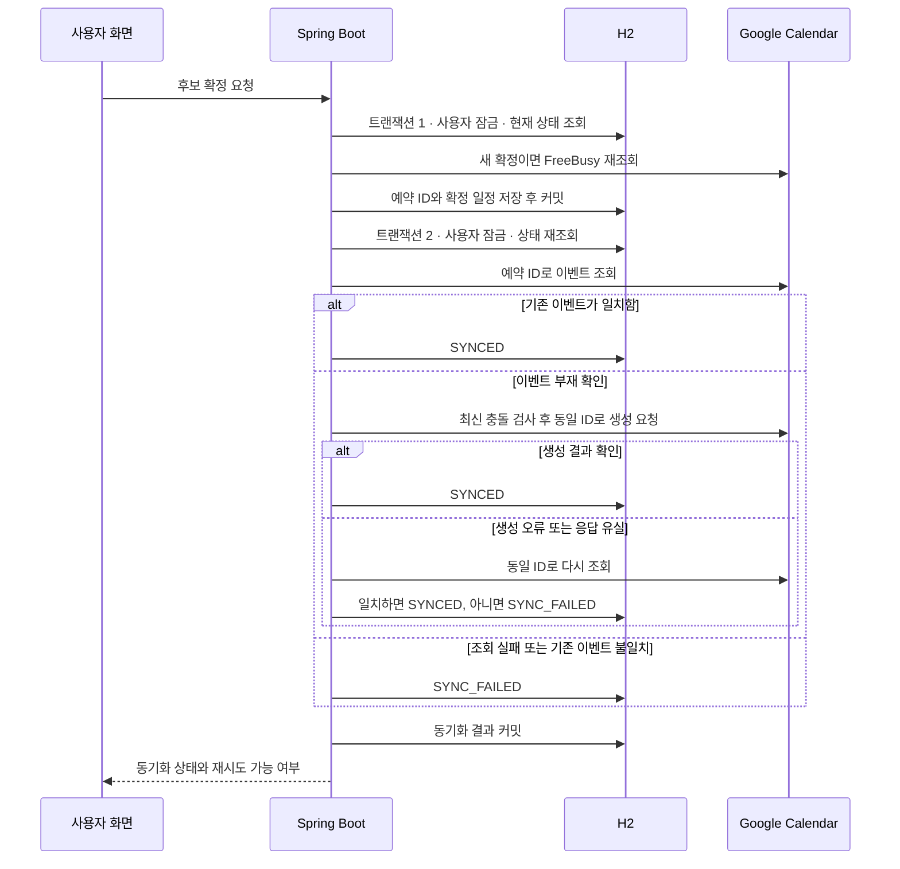

# Campus Planner

**자연어 기반 개인 맞춤형 일정 추천 및 Google Calendar 연동 시스템**

<kbd>Java 21</kbd> <kbd>Spring Boot 4.0.5</kbd> <kbd>React 19.3.1</kbd> <kbd>Docker Compose</kbd>

“목요일 저녁 여섯 시에 알고리즘 공부 두 시간 잡아줘.” Campus Planner는 이 문장에서 일정 조건을 추출하고, 수업과 기존 일정을 피해 배치할 수 있는 시간을 제안합니다. 사용자는 원래 요청에 맞는 시간과 대안을 비교하고, 고른 시간만 Google Calendar에 등록합니다.



## 해결하려는 문제

대학생이 공부·과제·약속을 잡으려면 빈 시간뿐 아니라 수업 전후 여유, 마감일, 꼭 지켜야 할 조건을 함께 확인해야 합니다. Campus Planner는 수업 시간표와 선호를 저장하고, 새 할 일을 입력할 때마다 가능한 시간을 비교할 수 있게 합니다. 분석한 할 일과 추천 이력을 다시 열어 계획을 이어갈 수도 있습니다.

| 단계 | 사용자 경험 |
| --- | --- |
| **입력·저장** | 문장으로 할 일을 입력하면 날짜·시각·소요 시간·필수 조건을 해석하고 할 일로 저장합니다. |
| **추천·비교** | 별도로 추천을 요청하면 최대 세 후보의 시간, 적합도, 추천 이유를 확인할 수 있습니다. |
| **선택·등록** | 후보를 골라 최종 등록을 요청하면 최신 일정을 다시 확인한 뒤 Google Calendar에 등록합니다. 연결 없이도 분석과 추천을 이용할 수 있습니다. |





## 시스템 구성



전시 배포 구성은 Lightsail의 Docker Compose에서 `web`과 단일 `app`을 실행하는 방식입니다. Nginx가 HTTPS를 처리하고 API와 OAuth 콜백을 내부 Spring Boot로 전달합니다. 로컬 개발에서는 Vite가 API를 프록시하고 Spring Boot가 로컬 파일 H2에 연결합니다. [Compose 설정](./compose.yaml) · [HTTPS 설정](./compose.https.yaml) · [Nginx 라우팅](./deploy/nginx/routes.conf) · [Vite 프록시](./frontend/vite.config.ts)

| 영역 | 기술 |
| --- | --- |
| Backend | Java 21, Spring Boot 4.0.5, Spring Security, JJWT 0.11.5 |
| Frontend | React 19.3.1, TypeScript 7.0.2, Vite 8.3.5 |
| Database | Spring Data JPA, Hibernate, 파일 기반 H2 |
| External APIs | OpenAI Responses API와 Structured Outputs, Google Calendar API v3와 OAuth 2.0 |
| Deployment | Docker Compose, Nginx, AWS Lightsail, HTTPS |

버전 기준은 [Gradle 설정](./build.gradle)과 [프론트엔드 잠금 파일](./frontend/package-lock.json)입니다. OpenAI 기본 모델은 [운영 프로파일](./src/main/resources/application-prod.yaml)의 `gpt-4o-mini`입니다.

## 핵심 백엔드 구현

### 자연어 해석과 추천 계산을 분리

`POST /tasks/natural-language`는 OpenAI Structured Outputs로 활동명, 날짜, 시작 시각, 소요 시간, 필수·선호 여부를 추출합니다. Java는 응답 형식과 조건을 검증하고, 요청을 받은 시점의 `Asia/Seoul` 기준으로 상대 날짜와 시각을 정규화합니다. 모순되거나 지원 범위를 벗어난 조건은 확인 또는 재입력을 요청합니다. 검증을 통과하면 조건과 입력 원문을 할 일에 저장하고, 추천은 별도 API에서 계산합니다. [OpenAI 클라이언트](./src/main/java/me/timetablescheduler/domain/llm/external/OpenAiClient.java) · [응답 검증](./src/main/java/me/timetablescheduler/domain/llm/service/LlmParsingService.java) · [시간 정규화](./src/main/java/me/timetablescheduler/domain/llm/service/LlmTemporalNormalizer.java)

### 필수 조건으로 거르고 선호 조건으로 순위를 계산

1. 탐색 기간과 가용 시간 안에서 30분 간격으로 시작 후보를 만들고, `19:10`처럼 명시한 시작 시각도 후보에 넣습니다.
2. 지난 시각, 소요 시간, 필수 날짜·시각, 허용 기간, 마감을 검사합니다. 수업·확정 일정·연결된 Google Calendar의 점유 구간에 최소 여유 시간을 더해 충돌 후보를 제외합니다.
3. 남은 후보를 점수화하고, 가능한 경우 원조건에 맞는 대표 후보와 시간이 겹치지 않는 대안을 최대 세 개 선정합니다. 최종 표시 순서는 원점수순입니다.

원점수는 **기본 50 + 선호 시간대 최대 30 + 마감 성향 최대 20 + 중요도 최대 30 + 일정 밀도 최대 10**입니다. 선호 시간대에 전체 일정이 들어가고, 기준일 다음 날의 보통 중요도 할 일이며, 마감·밀도 가점이 없는 후보라면 `50 + 30 + 0 + 13 + 0 = 93점`입니다. 화면의 추천 적합도는 이 점수를 후보 간 비교를 위해 100점 척도로 환산한 값입니다. 이 예에서는 `93 ÷ 140 × 100 ≈ 66.4점`으로 표시합니다. [후보 생성·점수 계산](./src/main/java/me/timetablescheduler/domain/recommendation/policy/RecommendationPolicy.java) · [중요도 점수](./src/main/java/me/timetablescheduler/domain/task/type/TaskPriority.java) · [후보 선정](./src/main/java/me/timetablescheduler/domain/recommendation/service/RecommendationService.java) · [표시 점수 테스트](./frontend/src/features/tasks/api/task-planning.api.test.ts)

### 같은 사용자의 확정 요청을 직렬화

추천을 만든 뒤 수업이나 일정이 바뀔 수 있습니다. 두 요청이 같은 빈 시간으로 판단하면 서로 다른 할 일도 겹쳐 확정될 수 있습니다. 그래서 확정 트랜잭션에서 사용자 행에 `PESSIMISTIC_WRITE` 잠금을 걸고, 최신 수업·선호·확정 일정·Calendar 점유 구간을 다시 확인합니다. 검증을 통과한 후보의 예약 ID와 확정 시간을 함께 저장합니다. 이 잠금이 조정하는 범위는 Campus Planner의 같은 사용자 요청입니다.

H2 통합 테스트에서 같은 후보를 동시에 선택하는 경우와 서로 다른 할 일이 같은 시간에 경쟁하는 경우를 재현해, 이벤트 생성이 한 번만 일어나는지 검증했습니다. [사용자 잠금](./src/main/java/me/timetablescheduler/domain/user/UserRepository.java) · [확정 통합 테스트](./src/test/java/me/timetablescheduler/domain/recommendation/service/RecommendationSelectionIntegrationTest.java)

### Google Calendar의 등록 결과가 불명확할 때 복구

Google이 이벤트를 만든 뒤 응답이 유실되거나, 등록 성공 직후 로컬 DB 커밋이 실패할 수 있습니다. 이를 대비해 **이벤트를 생성하기 전에 예약 ID를 저장하고 커밋**합니다. 두 번째 트랜잭션은 같은 사용자 잠금을 다시 잡고, 예약 ID로 이벤트를 조회합니다. 이벤트가 있으면 내용과 동기화 표식을 대조하고, 부재가 확인되면 최신 충돌 검사를 통과한 뒤 같은 ID로 생성을 요청합니다.



도식은 첫 트랜잭션을 통과한 새 확정의 조회·생성 흐름입니다. 두 번째 충돌 검사에서 후보가 거절되면 오류를 반환하고 두 번째 트랜잭션을 롤백합니다. 두 번째 커밋이 실패한 경우에도 첫 트랜잭션에서 저장한 예약 ID는 남습니다. UI는 서버가 복구 가능하다고 표시한 `SELECTED`·`SYNC_FAILED` 후보에 같은 확정 API로 재시도를 제공합니다. 이미 `SYNCED`인 요청에는 저장된 결과를 반환합니다. 응답 유실·DB 커밋 실패·동시 요청은 Google API 대역과 H2를 사용해 검증했습니다. [동기화 상태 전이](./src/main/java/me/timetablescheduler/domain/recommendation/Recommendation.java) · [이벤트 ID와 조회 검증](./src/main/java/me/timetablescheduler/domain/calendar/external/GoogleCalendarClient.java) · [실패 복구 통합 테스트](./src/test/java/me/timetablescheduler/domain/calendar/external/GoogleCalendarSyncIntegrationTest.java)

### 인증과 데이터 보존

Spring Security는 보호 API에서 JWT를 검증합니다. 갱신할 때 refresh token을 교체하고, 로그아웃 시 저장된 refresh token을 폐기합니다. Google 연동은 별도 OAuth 흐름이며, 요청 사용자에 묶인 5분짜리 일회성 `state`를 콜백에서 검증하고 소비합니다. [인증·OAuth 설계](./docs/auth-security.md)

운영 H2 파일은 호스트 디렉터리에 보존해 컨테이너를 교체해도 같은 파일을 사용하도록 구성했습니다. 최초 생성은 별도 절차로 처리하고, 정상 기동은 `IFEXISTS=TRUE`로 기존 DB 파일을 요구합니다. 비파괴 초기화 SQL과 `ddl-auto=validate`로 스키마 호환성을 확인합니다. [H2 보존·재시작 검증](./docs/database-persistence.md) · [배포 및 백업 절차](./docs/deployment-lightsail.md)

## 문제 해결 기록

동시 확정과 등록 응답 유실은 위에서 설명한 것처럼 각각 **DB 내부 경쟁**과 **외부 API 호출 사이의 실패**로 다뤘습니다. 그 밖에 아래 결함을 재현하고 수정했습니다.

| 문제와 원인 | 수정 및 검증 |
| --- | --- |
| 당일의 지난 시각이 추천되고, ASAP 가점이 마감일에 가까울수록 높아짐 | 현재 시각보다 늦은 후보만 남기고, ASAP은 오늘부터 후보일까지 지난 일수를 차감하도록 수정. 과거 시각·가점 방향 경계 테스트를 추가했습니다. [정책 테스트](./src/test/java/me/timetablescheduler/domain/recommendation/policy/RecommendationPolicyTest.java) · `a320cd4` |
| 가까운 시간에 추천이 몰리고 30분 간격 밖의 정확 시각이 누락됨 | 정확 시각 후보와 원조건·변경 대안 구분을 도입. 고정 입력으로 후보·순위·제외 조건을 검증했습니다. [추천 개선 기록](./docs/t09-recommendation-quality.md) · `c89ead6` |
| LLM이 선호 시각을 필수로 해석하거나 활동명을 놓침 | 시간 언급과 필수 여부의 규칙을 분리하고 대조 예시를 추가. 동일한 Golden v1 문장으로 전후를 비교했습니다. [평가 보관본](./docs/llm-evaluation/results/2026-10-20/README.md) · `39c27e9` |
| 파일 DB 재기동에서 기존 데이터가 초기화될 수 있음 | Hibernate 자동 생성 대신 비파괴 SQL 초기화와 스키마 검증을 사용. 임시 파일 DB에 데이터를 저장한 뒤 재시작해 값과 식별자를 비교했습니다. [재시작 통합 테스트](./src/test/java/me/timetablescheduler/config/DatabasePersistenceIntegrationTest.java) · `14a7ea3` |

## 테스트와 검증

- **백엔드**는 후보 생성·시간 경계 단위 테스트, H2 기반 트랜잭션·동시성 통합 테스트, Google·OpenAI 대역을 사용한 오류·복구 테스트로 검증합니다.
- **프론트엔드**는 Vitest와 Testing Library로 로그인, 일정 등록·실패 복구, 공개 페이지와 주요 화면 흐름을 검증합니다. [등록 흐름 테스트](./frontend/src/app/components/planner-registration-flow.test.tsx) · [공개 페이지 테스트](./frontend/src/app/components/public-pages-flow.test.tsx)
- **2026-11-07 검증 기록**은 Gradle **605개**, React **279개** 통과입니다. README 작성 전 공개 페이지 변경 검증(`5e478bc`)의 결과입니다.

### 자연어 해석 평가

Golden v1의 한국어 일정 요청 40문장을 고정 시각과 `gpt-4o-mini`로 프롬프트 수정 전후 각각 1회 평가했습니다. 원본 응답과 Java 정규화·검증 결과를 따로 채점했습니다.

| 문장 단위 전체 일치 | 개선 전 | 개선 후 |
| --- | ---: | ---: |
| LLM 원본 | 1/40 (2.5%) | 20/40 (50.0%) |
| Java 정규화·검증 후 | 9/40 (22.5%) | 33/40 (82.5%) |

이 수치는 해당 40문장의 기대 결과 일치율입니다. Java 판정은 정규화된 값과 검증 결과, 할 일 객체 생성 가능 여부를 대상으로 합니다. 2차 집계는 당시 출력의 복원본이며 2차 문장별 결과와 manifest는 보관되지 않았습니다. 일반 테스트와 실제 API 평가는 별도 Gradle 태스크로 실행합니다. [측정 조건·원본 보관 범위](./docs/llm-evaluation/results/2026-10-20/README.md) · [평가 Runner](./docs/llm-evaluation-runner.md)

## 로컬 실행

**요구 환경**은 Java 21과 Node.js 22.12 이상입니다. 백엔드는 저장소의 Gradle Wrapper를 사용합니다.

1. 새 체크아웃에서는 Git에서 제외하는 `src/main/resources/application.properties`를 아래 예시로 작성합니다. 기존 로컬 설정이 있으면 필요한 항목만 확인합니다. 이 설정은 환경변수 이름만 참조합니다.

   ```properties
   spring.config.import=classpath:database.properties
   app.jwt.secret=${APP_JWT_SECRET}

   openai.api-key=${OPENAI_API_KEY:}
   openai.model=${OPENAI_MODEL:gpt-4o-mini}

   google.calendar.client-id=${GOOGLE_CALENDAR_CLIENT_ID:}
   google.calendar.client-secret=${GOOGLE_CLIENT_SECRET:}
   google.calendar.redirect-uri=${GOOGLE_CALENDAR_REDIRECT_URI:}
   google.calendar.scope=https://www.googleapis.com/auth/calendar
   google.calendar.application-name=Campus Planner
   google.calendar.time-zone=Asia/Seoul
   ```

2. 백엔드 터미널에서 `APP_JWT_SECRET`을 설정합니다. 새 로컬 환경이라면 아래 명령으로 개발용 키를 생성할 수 있습니다. 프로젝트 루트에서 실행하면 공유 설정이 `data/timetable-scheduler.mv.db`에 신규 스키마를 준비하거나 기존 스키마를 검증합니다.

   ```bash
   export APP_JWT_SECRET="$(openssl rand -hex 32)"
   ./gradlew bootRun
   ```

3. 다른 터미널에서 프론트엔드를 실행하고 브라우저에서 `http://127.0.0.1:5173`을 엽니다. Vite가 백엔드 `127.0.0.1:8080`으로 API를 전달합니다.

   ```bash
   npm --prefix frontend ci
   npm --prefix frontend run dev
   ```

공개 페이지는 프론트엔드만으로 볼 수 있고, 회원가입·로그인·시간표·선호 설정은 외부 API 키 없이 로컬 백엔드에서 사용할 수 있습니다. 자연어 분석에는 `OPENAI_API_KEY`가 필요합니다. Google Calendar 연동에는 `GOOGLE_CALENDAR_CLIENT_ID`, `GOOGLE_CLIENT_SECRET`, `GOOGLE_CALENDAR_REDIRECT_URI`를 설정합니다. 로컬 OAuth 리디렉션 URI는 브라우저 주소에 맞춰 `http://127.0.0.1:5173/api/calendar/oauth/callback`을 사용하고 Google 설정에도 같은 URI를 등록합니다. [로컬 인증 설정](./docs/auth-security.md) · [공유 DB 설정](./src/main/resources/database.properties)

일반 회귀 테스트는 외부 API 자격 증명 없이 실행합니다.

```bash
./gradlew test
npm --prefix frontend test
```

## 저장소 길잡이

| 위치 | 책임 |
| --- | --- |
| [`auth/`](./src/main/java/me/timetablescheduler/auth) · [`config/`](./src/main/java/me/timetablescheduler/config) | 사용자 인증, JWT, Spring 설정 |
| [`domain/llm/`](./src/main/java/me/timetablescheduler/domain/llm) · [`domain/task/`](./src/main/java/me/timetablescheduler/domain/task) | 자연어 해석, 검증, 할 일 저장 |
| [`domain/recommendation/`](./src/main/java/me/timetablescheduler/domain/recommendation) · [`domain/calendar/`](./src/main/java/me/timetablescheduler/domain/calendar) | 추천 정책, 확정, Calendar 연동과 복구 |
| [`domain/timetable/`](./src/main/java/me/timetablescheduler/domain/timetable) · [`domain/preference/`](./src/main/java/me/timetablescheduler/domain/preference) | 수업 시간표와 개인 선호 설정 |
| [`frontend/`](./frontend) · [`docs/`](./docs) | React 화면, 설계 결정, 검증 기록 |
